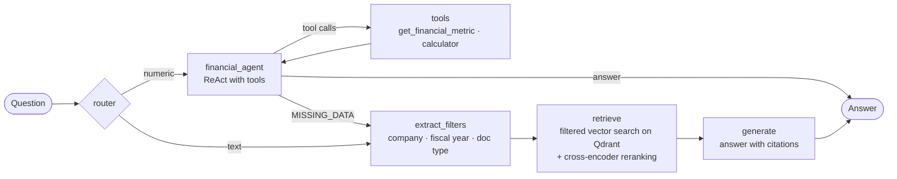

# FinRAG — Agentic RAG over SEC Filings

An agentic system that answers analyst-style questions about public companies using their SEC filings (10-K, 10-Q, 8-K, earnings releases, annual reports).
A router sends each question either to a **retrieval pipeline** over the filings (RAG) or to a **financial agent** that reads structured **XBRL** data and computes the answer with tools.
Built with **LangGraph**, **Qdrant** and **EmbeddingGemma 2**, and evaluated on **FinanceBench** with **Langfuse**.

The goal of the project is not only to build the system, but to **measure every design decision**: each technique is added on top of a baseline and kept only if it improves the metrics.

---

## Why this problem

Financial questions are hard for LLMs: answers are buried in documents of hundreds of pages, many of them in tables, and often require combining numbers from different financial statements.
In the FinanceBench paper, GPT-4-Turbo with a shared vector store over all filings answered correctly only **19%** of the questions, and refused or answered incorrectly in most of the others. Two bottlenecks emerge: **retrieval** (finding the right page, in the right document, for the right year) and **numerical reasoning** (reading the right column of a table and computing ratios correctly).

---

## Architecture



| Node | What it does |
| --- | --- |
| `router` | Classifies the question with structured output: `numeric` if the answer can be computed from annual financial statement line items, `text` otherwise (qualitative questions, quarterly data, non-GAAP metrics, guidance, segment breakdowns). Reasoning disabled: it is a simple classification. |
| `financial_agent` | A ReAct loop: the model decides which metrics to read and which calculations to run, calling the tools until it can answer. It uses the formula given in the question, or states the definition it applies when none is given. |
| `tools` | `get_financial_metric(company, metric, fiscal_year)` reads one annual value from the XBRL table and returns it with its source; `calculator` evaluates arithmetic expressions safely (AST-based, no `eval`). |
| `extract_filters` | An LLM with structured output extracts company, fiscal year and document type from the question. A field is filled only if it is clearly stated; otherwise it is left empty (no filter). |
| `retrieve` | Semantic search over the page index, restricted by the extracted filters (20 candidates), then a cross-encoder reranker keeps the most relevant pages. |
| `generate` | Answers using only the retrieved pages, with explicit citations `[document, page N]`, a fixed output format and a mandatory refusal when the information is missing. |

**Fallback.** If a value needed by the financial agent is not available in XBRL, the agent replies with a fixed `MISSING_DATA` line and the question is rerouted to the RAG branch. The original question is kept in the graph state, so the RAG nodes never see the intermediate tool messages.

---

## Data

### Dataset
- **FinanceBench** open-source sample: **150 questions** with reference answers and evidence pages ([paper](https://arxiv.org/abs/2311.11944), [dataset](https://huggingface.co/datasets/PatronusAI/financebench)), licensed CC BY-NC 4.0.
- Three question types, 50 each: `domain-relevant`, `novel-generated`, `metrics-generated`.
- **Split**: 51 development questions (17 per type, stratified) and 99 test questions, fixed with a seed and versioned in `evals/`. Development questions are used to iterate; test questions only for final measurements.

### Corpus
- All **368 PDFs** from the FinanceBench repository are indexed, not only the 84 documents referenced by the open-source questions. The other documents act as realistic distractors, as in the original paper.
- 2 PDFs (Intel 8-Ks) are corrupted and excluded; none of them is referenced by the questions.
- **53,901 pages** extracted with `pypdf`; pages with fewer than 100 characters (654, mostly covers and separators) are discarded → **53,247 indexed pages**.

### Data quality checks
- **Page alignment**: all 189 evidence pages of the 150 questions were matched against the extracted pages. All were found, none is empty, and the shortest one has 688 characters (so the 100-character threshold never drops an answer page).
- **Extraction fidelity**: the extracted text was compared with the evidence text provided by FinanceBench. Median similarity is 0.997; 18 evidence pages have lower similarity because of different table layouts. No page-numbering offsets were found.
- **Multi-document questions**: all 150 questions have their evidence in a **single document**. 35 questions need multiple pages of that document (e.g. balance sheet + income statement); 38 mention several fiscal years, but the most recent filing contains all of them.
- **Naming anomalies**: one document name misspells the company (`ACTIVSIONBLIZZARD_2023Q2_10Q`). The document name is kept as is (it is the key used by the evidence pages), while the `company` field is normalized so that filters treat it as Activision Blizzard.

### Financial statement data (XBRL)
Structured figures come from the SEC **companyfacts** API (EDGAR), one JSON file per company, downloaded once and stored locally.

- **1,125,858 raw facts** for the 41 companies of the corpus, flattened into one table (company, XBRL concept, unit, value, period, form, filing date).
- **Annual table**: only 10-K annual values over a ~1-year period (instant balance sheet items kept as is), one value per company, concept and fiscal year, keeping the **originally reported** value (earliest filing) rather than later restatements → **184,890 rows**.
- **Fiscal year**: derived from the period end date, not from the filing's `fy` field (which is the year of the document, not of the figure). Companies with 52/53-week years ending in early January (e.g. J&J FY2020 ending on 2021-01-03) are assigned to the previous year.
- **Metric vocabulary** (`metrics.json`): 16 metrics derived from the `metrics-generated` questions (revenue, COGS, operating income, net income, D&A, capex, operating cash flow, dividends, total/current assets, current liabilities, inventory, receivables, payables, net PP&E). Each metric maps to an ordered list of **equivalent** XBRL concepts, tried in order per company and year. Concepts that cover only part of a line item (e.g. finished goods inventory) are excluded: a missing value falls back to the filings, a partial value would silently produce a wrong answer.
- **Coverage** on the 270 company-years of the corpus: 100% for net income, operating cash flow and total assets, 96% for revenue, 73–80% for dividends, D&A, COGS and inventory. Most gaps are real (companies that pay no dividends, hold no inventory, or do not report COGS or current assets, such as banks and utilities).
- **Validation**: values read through the tool match the evidence pages (e.g. 3M FY2018 capex $1,577M, Adobe FY2015 current liabilities $2,213.6M). On five `metrics-generated` questions computed by hand from XBRL, all values were correct; the only mismatches came from formulas not specified in the question (e.g. inventory turnover on ending vs average inventory).

---

## Indexing

| Choice | Value | Rationale |
| --- | --- | --- |
| Chunking | **one chunk per page** | Page-level chunking had the best and most stable accuracy on paginated financial PDFs in NVIDIA's chunking benchmark; it keeps tables intact and matches the page-level evidence of FinanceBench. |
| Embedding model | **EmbeddingGemma 2** (768 dims, BF16, local GPU) | Strong model under 1B parameters, 8K-token context (the longest page fits), runs locally for free. Must not run in FP16. |
| Document prefix | `title: {doc_name} \| text: {page}` | The model card format; the title gives each page its company/year/type context. |
| Query prefix | `task: question answering \| query: {question}` | Asymmetric retrieval prompt from the model card. |
| Vector store | **Qdrant** (Docker), cosine distance | Native payload filtering on metadata. |
| Point IDs | `uuid5(doc_name + page_num)` | Deterministic: re-running the ingestion overwrites instead of duplicating. |

Embedding the whole corpus took **71 minutes** on an RTX 4050 Laptop GPU (6 GB VRAM, batch size 3).

### Metadata
`company`, `fiscal_year`, `period` and `doc_type` are parsed from the document names with a regular expression that handles the irregular cases of the dataset (companies with underscores such as `JOHNSON_JOHNSON` and `PG_E`, 8-Ks without a year, lowercase `annualreport`, mixed `_`/`-` separators). They are stored in the Qdrant payload with payload indexes (`keyword` / `integer`).

---

## Models

| Role | Model | Notes |
| --- | --- | --- |
| Generator | `nvidia/nemotron-3.5-super-vl:free` (OpenRouter) | `temperature=0` |
| Router | same as generator | Structured output, reasoning disabled (`reasoning.effort = "none"`): ~1.6 s per question |
| Financial agent | same as generator | Tool calling (`bind_tools`), low reasoning effort |
| Filter extraction | same as generator | Structured output with Pydantic; company constrained to the codes in the index (`Literal`) |
| Judge | `google/gemma-4-26b-a4b-it` (OpenRouter) | Different model family from the generator, to avoid self-preference bias |
| Embeddings | `google/embeddinggemma-2` | Local, BF16 |
| Reranker | `cross-encoder/ettin-reranker-400m-v1` | Local cross-encoder, BF16, 8K-token context (long pages fit) |

The model reasons by default, and reasoning tokens count against the output limit: without an explicit limit, the router once spent its whole 4,000-token budget reasoning on a two-way classification and never produced an answer. Reasoning is therefore set explicitly per node through OpenRouter's `reasoning` parameter.

---

## Evaluation

All experiments run on the same 51 development questions with **Langfuse** datasets and experiments.

| Metric | Type | What it measures |
| --- | --- | --- |
| `hit_rate` | deterministic | At least one evidence page is among the retrieved pages |
| `evidence_recall` | deterministic | Fraction of the evidence pages that were retrieved (relevant for multi-page questions) |
| `correctness` | LLM-as-judge | The answer agrees with the reference answer |
| `route_numeric`, `fallback` | deterministic | Share of questions sent to the financial agent, and of those rerouted to the RAG branch |

With the router, `hit_rate` and `evidence_recall` are computed **only on questions that went through the RAG branch**: questions answered from XBRL retrieve no pages.

### The judge
The judge compares the candidate answer with the reference answer and returns a structured verdict (reasoning first, then a boolean). Its prompt encodes domain rules:
- numbers are equivalent across formatting, consistent units and small rounding differences;
- qualitative answers must reach the same conclusion without contradicting the reference;
- refusals are incorrect;
- **the reference answer is the ground truth**: the judge must not decide which answer is "more accurate" or use its own knowledge (judge v2, introduced after observing this failure mode). Suspected errors in the reference are reported in the reasoning, not in the verdict.

**Judge stability**: on identical system answers, at least 2 questions changed verdict between runs. Both are borderline cases, where the answer reaches the right conclusion but uses a different breakdown than the reference (e.g. products vs services instead of business segments). Differences of 1–2 questions between experiments are therefore treated as noise.

---

## Results

Development set (51 questions), top-5 pages. Retrieval metrics are independent of the judge.

| Experiment | Hit rate | Evidence recall | Correctness |
| --- | --- | --- | --- |
| Baseline (page index + title, no filters) | 0.57 | 0.48 | 0.69 |
| + metadata filters (company, fiscal year, doc type) | 0.57 | 0.51 | 0.76 |
| + improved filter prompt (forecasts, dates) | 0.59 | 0.53 | 0.77 |
| + cross-encoder reranking (20 candidates → top 5) | 0.71 | 0.65 | 0.84 |

### Number of pages passed to the generator

Same pipeline (filters + reranking over 20 candidates), changing only how many reranked pages reach the generator.

| Pages to the generator | Hit rate | Evidence recall | Correctness |
| --- | --- | --- | --- |
| 5 | 0.71 | 0.65 | 0.84 |
| 8 | 0.77 | 0.73 | 0.84 |

Average correctness is unchanged, but the per-question view tells a different story:
- **a real gain on multi-statement questions.** For the Adobe operating cash flow ratio, the balance sheet was ranked 6th after reranking: with 5 pages it was left out and the model correctly refused; with 8 pages both statements are in the context and the model computes the exact answer (0.66).
- **a case that more context does not fix.** For the AES inventory turnover, both required statements are now in the context, but the answer is still wrong: the model keeps arguing that the ratio is not meaningful for a utility instead of computing it. This is a reasoning error, not a retrieval one.
- **a loss that is judge noise.** One question flipped from correct to incorrect with a word-for-word identical answer (a borderline case, see *Judge stability*).
- all other answers are unchanged.

With 51 questions and a judge that can flip 1–2 borderline verdicts, the average hides the effect: per-question inspection shows that more pages fix exactly the failure mode found in the error analysis (questions needing two financial statements), at the cost of a ~60% longer context.

### Router + financial agent on XBRL data

The full graph (router, financial agent with tools, RAG branch with 8 reranked pages), compared with the RAG-only pipeline with the same retrieval settings.

| Experiment | Correctness | Questions to the financial agent | Fallbacks to RAG |
| --- | --- | --- | --- |
| RAG only (filters + reranking, 8 pages) | 0.84 | — | — |
| Router + XBRL financial agent | 0.84 | 22 / 51 | 0 |

- **Routing**: all 17 `metrics-generated` questions go to the financial agent, all 17 `novel-generated` questions go to the RAG branch, and 5 `domain-relevant` questions go to the agent (operating margin, inventory turnover, working capital, capital intensity), all of them computable from financial statement items.
- **Same accuracy, different answers.** The questions answered incorrectly are the same in both systems, but numeric answers are now computed from exact reported values, show the formula, and cite the XBRL concept of every number instead of a page.
- **Fewer refusals.** Questions that the RAG pipeline refused because a financial statement was not retrieved can now be answered from XBRL. For PayPal's working capital, the RAG pipeline could not find the balance sheet and refused; the agent reads current assets and liabilities from XBRL, computes the result, and explains that most of PayPal's current items are customer funds, which limits the meaning of the metric. The reference uses a definition that excludes them, so the answer is still judged incorrect.
- **Shorter context** for numeric questions: a few hundred tokens of values instead of several pages of financial statements.

Hit rate and evidence recall of this experiment (0.66 and 0.63) are computed on the 29 questions of the RAG branch only, so they are not comparable with the table above.

---

## Error analysis

### Retrieval
Retrieval failures of the baseline fall into three categories: wrong company, right company but wrong year or document (addressed by the metadata filters), and right document but wrong page (addressed by reranking).

- **Multi-statement questions** (e.g. ratios combining balance sheet and income statement) often retrieve only one of the two required pages (`evidence_recall = 0.5`). With a single query vector, the top results cluster around one statement. Passing more reranked pages or reading the values from XBRL solves these cases.
- Inside the correct document, similarity scores of the top pages are very close (e.g. 0.846 vs 0.829), which made page ranking the main bottleneck before reranking.
- **Retrieval metrics underestimate the system**: in 13 of 51 questions the system answers correctly without retrieving the annotated evidence page, because the same information appears in several pages or filings (e.g. a figure from a later 10-K that reports the year as comparison).

### Residual errors
After routing, the 8 incorrect answers fall into categories that neither better retrieval nor better tools can fix:

| Question | Branch | Cause |
| --- | --- | --- |
| Corning, working capital | numeric | Standard definition (current assets − current liabilities) vs an "operating" definition in the reference |
| PayPal, working capital | numeric | Standard definition vs one that excludes customer funds (previously a refusal) |
| AES, inventory turnover | numeric | Average vs ending inventory: the question does not specify the formula |
| J&J, adjusted EPS growth | text | Operational vs reported variant of the metric |
| Best Buy, number of stores | text | Stores under the Best Buy brand vs total stores in the reference table |
| Boeing, revenue categories | text | Products vs services instead of business segments; borderline, the judge flips |
| American Express, geographies | text | Countries with the largest credit exposure instead of reporting regions; borderline, the judge flips |
| Pfizer, spin-off | text | Refusal: evidence page not retrieved; the reference itself is questionable (the Upjohn separation was completed in 2020) |

When the information is missing, the system **refuses or falls back** instead of hallucinating a number: no residual error comes from an invented value or a wrong calculation.

---

## Roadmap

- [x] Data checks, page-level index, baseline RAG graph
- [x] Evaluation pipeline (hit rate, evidence recall, LLM judge) on Langfuse
- [x] Metadata extraction and filtered retrieval
- [x] Cross-encoder reranking
- [x] Numerical tools on XBRL data (SEC `companyfacts` API), router and financial agent with fallback to RAG
- [ ] MCP server exposing the search and financial tools
- [ ] Conversational interface (memory, query rewriting for follow-up questions)
- [ ] Final evaluation on the test set

---

## Project structure

```
financial_agentic_rag/
├── src/finrag/
│   ├── config.py           # models, collection, cached resources (encoder, reranker, Qdrant, LLM)
│   ├── schemas.py          # Pydantic schemas (QueryFilters, Route)
│   ├── companies.json      # company codes allowed in the filters
│   ├── company_cik.json    # company code → ticker and SEC CIK
│   ├── metrics.json        # metric vocabulary: metric → equivalent XBRL concepts
│   ├── xbrl.py             # flattening and cleaning of companyfacts, get_metric
│   ├── tools.py            # search_pages, rerank_pages, filter extraction, financial tools
│   ├── prompts.py          # router, agent, generation, filter extraction and judge prompts
│   ├── agents.py           # LangGraph state, nodes and graph
│   └── eval_langhfuse.py   # Langfuse task and evaluators
├── notebooks/              # data exploration, ingestion, checks
├── scripts/                # dataset creation, experiments
├── evals/                  # dev/test split (financebench_id → split)
└── data/                   # raw PDFs, XBRL JSON, extracted pages, embeddings (not versioned)
```

---

## How to run

1. **Environment**: Python 3.12, `pip install -e .`, PyTorch with CUDA.
2. **Secrets** in `.env`: `OPENROUTER_API_KEY`, `LANGFUSE_PUBLIC_KEY`, `LANGFUSE_SECRET_KEY`, `LANGFUSE_HOST`, `SEC_USER_AGENT` (name and contact email, required by the SEC).
3. **Qdrant**: `docker run -d --name qdrant -p 6333:6333 -p 6334:6334 -v "<project>/qdrant_storage:/qdrant/storage" qdrant/qdrant`
4. **Filings**: download the FinanceBench questions and PDFs, extract pages, compute embeddings, load Qdrant, add metadata (notebooks in `notebooks/`).
5. **XBRL data**: download companyfacts for the companies in `company_cik.json`, flatten and clean them into `xbrl_facts_annual.parquet`.
6. **Evaluation**: create the Langfuse dataset, then run the experiments script.

---

## Limitations

- FinanceBench questions are single-company and single-turn; cross-company comparisons are not covered by the reference answers.
- Some reference answers are ambiguous or contestable, as acknowledged by the FinanceBench authors; most residual errors are differences in metric definitions.
- The XBRL tools cover annual 10-K line items only: quarterly figures, non-GAAP metrics, guidance and segment breakdowns go through the RAG branch.
- The development set has 51 questions: differences of one or two answers between experiments are within noise.
- The generator currently runs on a free OpenRouter endpoint; cost per question is not yet reported.

---

## References

- Islam et al., *FinanceBench: A New Benchmark for Financial Question Answering*, 2023
- Zheng et al., *Judging LLM-as-a-Judge with MT-Bench and Chatbot Arena*, NeurIPS 2023
- Yao et al., *ReAct: Synergizing Reasoning and Acting in Language Models*, 2022
- Jeong et al., *Adaptive-RAG: Learning to Adapt Retrieval-Augmented Large Language Models through Question Complexity*, 2024
- Nogueira & Cho, *Passage Re-ranking with BERT*, 2019
- Anthropic, *Introducing Contextual Retrieval*, 2024
- Anthropic, *Building effective agents*, 2024
- NVIDIA, *Finding the Best Chunking Strategy for Accurate AI Responses*
- Google, *EmbeddingGemma 2* model card
- SEC, *EDGAR Application Programming Interfaces*