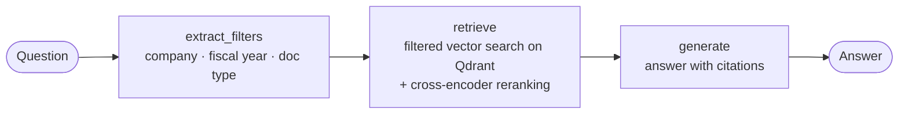

# FinRAG — Agentic RAG over SEC Filings

An agentic Retrieval-Augmented Generation system that answers analyst-style questions about public companies using their SEC filings (10-K, 10-Q, 8-K, earnings releases, annual reports).
Built with **LangGraph**, **Qdrant** and **EmbeddingGemma 2**, and evaluated on **FinanceBench** with **Langfuse**.

The goal of the project is not only to build the system, but to **measure every design decision**: each technique is added on top of a baseline and kept only if it improves the metrics.

---

## Why this problem

Financial questions are hard for LLMs: answers are buried in documents of hundreds of pages, many of them in tables, and often require combining numbers from different financial statements.
In the FinanceBench paper, GPT-4-Turbo with a shared vector store over all filings answered correctly only **19%** of the questions, and refused or answered incorrectly in most of the others. The main bottleneck is **retrieval**: finding the right page, in the right document, for the right year.

---

## Architecture



| Node | What it does |
| --- | --- |
| `extract_filters` | An LLM with structured output extracts company, fiscal year and document type from the question. A field is filled only if it is clearly stated; otherwise it is left empty (no filter). |
| `retrieve` | Semantic search over the page index, restricted by the extracted filters (20 candidates), then a cross-encoder reranker keeps the 5 most relevant pages. |
| `generate` | Answers using only the retrieved pages, with explicit citations `[document, page N]`, a fixed output format and a mandatory refusal when the information is missing. |

The baseline graph has no `extract_filters` node (`build_graph(use_filters=False)`).

---

## Data

### Dataset
- **FinanceBench** open-source sample: **150 questions** with reference answers and evidence pages ([paper](https://arxiv.org/abs/2311.11944), [dataset](https://huggingface.co/datasets/PatronusAI/financebench)), licensed CC BY-NC 4.0.
- Three question types, 50 each: `domain-relevant`, `novel-generated`, `metrics-generated`.
- **Split**: 51 development questions (17 per type, stratified) and 99 test questions, fixed with a seed and versioned in `evals/`. Development questions are used to iterate; test questions only for final measurements.

### Corpus
- All **368 PDFs** from the FinanceBench repository are indexed, not only the 84 documents referenced by the open-source questions. The other documents act as realistic distractors, as in the original paper.
- 2 PDFs (Intel 8-Ks) are corrupted and excluded; none of them is referenced by the questions.
- **53,901 pages** extracted with `pypdf`; pages with fewer than 100 characters (654, mostly covers and separators) are discarded → **53,247 indexed pages**.

### Data quality checks
- **Page alignment**: all 189 evidence pages of the 150 questions were matched against the extracted pages. All were found, none is empty, and the shortest one has 688 characters (so the 100-character threshold never drops an answer page).
- **Extraction fidelity**: the extracted text was compared with the evidence text provided by FinanceBench. Median similarity is 0.997; 18 evidence pages have lower similarity because of different table layouts. No page-numbering offsets were found.
- **Multi-document questions**: all 150 questions have their evidence in a **single document**. 35 questions need multiple pages of that document (e.g. balance sheet + income statement); 38 mention several fiscal years, but the most recent filing contains all of them.

---

## Indexing

| Choice | Value | Rationale |
| --- | --- | --- |
| Chunking | **one chunk per page** | Page-level chunking had the best and most stable accuracy on paginated financial PDFs in NVIDIA's chunking benchmark; it keeps tables intact and matches the page-level evidence of FinanceBench. |
| Embedding model | **EmbeddingGemma 2** (768 dims, BF16, local GPU) | Strong model under 1B parameters, 8K-token context (the longest page fits), runs locally for free. Must not run in FP16. |
| Document prefix | `title: {doc_name} \| text: {page}` | The model card format; the title gives each page its company/year/type context. |
| Query prefix | `task: question answering \| query: {question}` | Asymmetric retrieval prompt from the model card. |
| Vector store | **Qdrant** (Docker), cosine distance | Native payload filtering and hybrid search for the next steps. |
| Point IDs | `uuid5(doc_name + page_num)` | Deterministic: re-running the ingestion overwrites instead of duplicating. |

Embedding the whole corpus took **71 minutes** on an RTX 4050 Laptop GPU (6 GB VRAM, batch size 3).

### Metadata
`company`, `fiscal_year`, `period` and `doc_type` are parsed from the document names with a regular expression that handles the irregular cases of the dataset (companies with underscores such as `JOHNSON_JOHNSON` and `PG_E`, 8-Ks without a year, lowercase `annualreport`, mixed `_`/`-` separators). They are stored in the Qdrant payload with payload indexes (`keyword` / `integer`).

---

## Models

| Role | Model | Notes |
| --- | --- | --- |
| Generator | `nvidia/nemotron-3.5-lightning` (OpenRouter) | `temperature=0` |
| Filter extraction | same as generator | Structured output with Pydantic; company constrained to the codes in the index (`Literal`) |
| Judge | `google/gemma-4-26b-a4b-it` (OpenRouter) | Different model family from the generator, to avoid self-preference bias |
| Embeddings | `google/embeddinggemma-2` | Local, BF16 |
| Reranker | `cross-encoder/ettin-reranker-400m-v1` | Local cross-encoder, BF16, 8K-token context (long pages fit) |

---

## Evaluation

All experiments run on the same 51 development questions with **Langfuse** datasets and experiments.

| Metric | Type | What it measures |
| --- | --- | --- |
| `hit_rate` | deterministic | At least one evidence page is among the retrieved pages |
| `evidence_recall` | deterministic | Fraction of the evidence pages that were retrieved (relevant for multi-page questions) |
| `correctness` | LLM-as-judge | The answer agrees with the reference answer |

### The judge
The judge compares the candidate answer with the reference answer and returns a structured verdict (reasoning first, then a boolean). Its prompt encodes domain rules:
- numbers are equivalent across formatting, consistent units and small rounding differences;
- qualitative answers must reach the same conclusion without contradicting the reference;
- refusals are incorrect;
- **the reference answer is the ground truth**: the judge must not decide which answer is "more accurate" or use its own knowledge (judge v2, introduced after observing this failure mode). Suspected errors in the reference are reported in the reasoning, not in the verdict.

**Judge stability**: on identical system answers, at least 2 questions changed verdict between runs. Both are borderline cases, where the answer reaches the right conclusion but uses a different breakdown than the reference (e.g. products vs services instead of business segments). Differences of 1–2 questions between experiments are therefore treated as noise.

---

## Results

Development set (51 questions), top-5 pages. Retrieval metrics are independent of the judge.

| Experiment | Hit rate | Evidence recall | Correctness |
| --- | --- | --- | --- |
| Baseline (page index + title, no filters) | 0.57 | 0.48 | 0.69 |
| + metadata filters (company, fiscal year, doc type) | 0.57 | 0.51 | 0.76 |
| + improved filter prompt (forecasts, dates) | 0.59 | 0.53 | 0.77 |
| + cross-encoder reranking (20 candidates → top 5) | 0.71 | 0.65 | 0.84 |

### Number of pages passed to the generator

Same pipeline (filters + reranking over 20 candidates), changing only how many reranked pages reach the generator.

| Pages to the generator | Hit rate | Evidence recall | Correctness |
| --- | --- | --- | --- |
| 5 | 0.71 | 0.65 | 0.84 |
| 8 | 0.77 | 0.73 | 0.84 |

Average correctness is unchanged, but the per-question view tells a different story:
- **a real gain on multi-statement questions.** For the Adobe operating cash flow ratio, the balance sheet was ranked 6th after reranking: with 5 pages it was left out and the model correctly refused; with 8 pages both statements are in the context and the model computes the exact answer (0.66).
- **a case that more context does not fix.** For the AES inventory turnover, both required statements are now in the context, but the answer is still wrong: the model keeps arguing that the ratio is not meaningful for a utility instead of computing it. This is a reasoning error, not a retrieval one.
- **a loss that is judge noise.** One question flipped from correct to incorrect with a word-for-word identical answer (a borderline case, see *Judge stability*).
- all other answers are unchanged.

With 51 questions and a judge that can flip 1–2 borderline verdicts, the average hides the effect: per-question inspection shows that more pages fix exactly the failure mode found in the error analysis (questions needing two financial statements), at the cost of a ~60% longer context. The same questions are also the target of the numerical tools of the next step, which return figures such as current liabilities or operating cash flow directly.

---

## Error analysis

Retrieval failures of the baseline fall into three categories: wrong company, right company but wrong year or document (addressed by the metadata filters), and right document but wrong page (to be addressed by hybrid search and reranking).

Observations so far:
- **Multi-statement questions** (e.g. ratios combining balance sheet and income statement) often retrieve only one of the two required pages (`evidence_recall = 0.5`). With a single query vector, the top results cluster around one statement.
- When the information is missing, the generator **refuses with an explanation** instead of hallucinating a number, as required by the prompt.
- Inside the correct document, similarity scores of the top pages are very close (e.g. 0.846 vs 0.829), which makes page ranking the main bottleneck.

---

## Roadmap

- [x] Data checks, page-level index, baseline RAG graph
- [x] Evaluation pipeline (hit rate, evidence recall, LLM judge) on Langfuse
- [x] Metadata extraction and filtered retrieval
- [x] Cross-encoder reranking
- [ ] Fallback search when filters are too restrictive
- [ ] Hybrid search (BM25 + dense)
- [ ] Contextual chunks / token-level chunking experiments
- [ ] Numerical tools on XBRL data (SEC `companyfacts` API) and query routing
- [ ] Agentic retrieval (ReAct / query decomposition for multi-statement questions)
- [ ] MCP server exposing the search and financial tools
- [ ] Final evaluation on the test set

---

## Project structure

```
financial_agentic_rag/
├── src/finrag/
│   ├── config.py           # models, collection, cached resources (encoder, Qdrant, LLM)
│   ├── schemas.py          # Pydantic schemas (QueryFilters)
│   ├── companies.json      # company codes allowed in the filters
│   ├── tools.py            # search_pages, extract_filter_from_query
│   ├── prompts.py          # generation, filter extraction and judge prompts
│   ├── agent.py            # LangGraph state, nodes and graph
│   └── eval_langhfuse.py   # Langfuse tasks and evaluators
├── notebooks/              # data exploration, ingestion, checks
├── scripts/                # dataset creation, experiments
├── evals/                  # dev/test split (financebench_id → split)
└── data/                   # raw PDFs, extracted pages, embeddings (not versioned)
```

---

## How to run

1. **Environment**: Python 3.12, `pip install -e .`, PyTorch with CUDA.
2. **Secrets** in `.env`: `OPENROUTER_API_KEY`, `LANGFUSE_PUBLIC_KEY`, `LANGFUSE_SECRET_KEY`, `LANGFUSE_HOST`.
3. **Qdrant**: `docker run -d --name qdrant -p 6333:6333 -p 6334:6334 -v "<project>/qdrant_storage:/qdrant/storage" qdrant/qdrant`
4. **Data**: download the FinanceBench questions and PDFs, extract pages, compute embeddings, load Qdrant, add metadata (notebooks in `notebooks/`).
5. **Evaluation**: create the Langfuse dataset, then run the experiments script.

---

## Limitations

- FinanceBench questions are single-company and single-turn; cross-company comparisons are not covered by the reference answers.
- Some reference answers are ambiguous or contestable, as acknowledged by the FinanceBench authors.
- The development set has 51 questions: differences of one or two answers between experiments are within noise.
- The generator currently runs on a free OpenRouter endpoint; cost per question is not yet reported.

---

## References

- Islam et al., *FinanceBench: A New Benchmark for Financial Question Answering*, 2023
- Zheng et al., *Judging LLM-as-a-Judge with MT-Bench and Chatbot Arena*, NeurIPS 2023
- Anthropic, *Introducing Contextual Retrieval*, 2024
- NVIDIA, *Finding the Best Chunking Strategy for Accurate AI Responses*
- Google, *EmbeddingGemma 2* model card